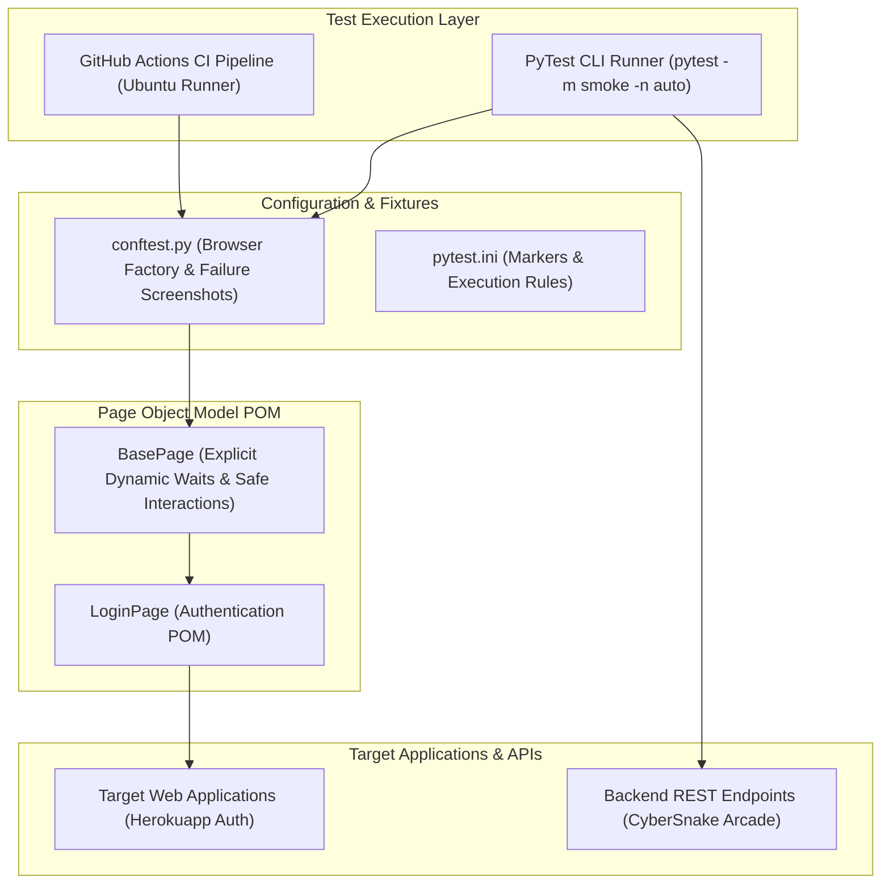

# :test_tube: Production QA Test Automation Framework

[](https://python.org)
[](https://selenium.dev)
[](https://pytest.org)
[](.github/workflows/test.yml)

An enterprise-grade, maintainable QA test automation framework built on **Python**, **Selenium WebDriver 4**, and **PyTest**. Implements the **Page Object Model (POM)** architectural pattern, cross-browser support, automated failure screenshots, REST API contract and latency SLA validation, and automated GitHub Actions CI/CD test reporting.

---

## :triangular_ruler: Framework Architecture



---

## :sparkles: Key Features

- **Page Object Model (POM)**: Complete decoupling of test logic from DOM locators for maximum maintainability.
- **Deterministic Explicit Waits**: Zero hardcoded `sleep` or mixed implicit waits. Dynamic synchronization via `WebDriverWait` and `expected_conditions`.
- **Automatic Failure Screenshots**: Test failures automatically capture browser screenshots and attach them directly to HTML reports.
- **Cross-Browser & Headless Control**: Headless by default for CI efficiency; pass `--headed` to inspect browser execution locally.
- **Parallel Test Execution**: Full compatibility with `pytest-xdist` (`-n auto`).
- **REST API & Latency SLA Checks**: Unified runner testing both UI flows and backend HTTP contract/SLA compliance.
- **CI/CD Pipeline**: GitHub Actions workflow builds, runs tests, and archives self-contained HTML reports and failure screenshots.

---

## :rocket: Quickstart

### 1. Installation

```bash
git clone https://github.com/Aryan-136/qa-automation-framework.git
cd qa-automation-framework

# Create and activate virtual environment
python -m venv venv
source venv/bin/activate       # On Windows: .\venv\Scripts\Activate.ps1

# Install dependencies
pip install -r requirements.txt
```

### 2. Running Tests

```bash
# Run all tests (headless by default)
pytest

# Run critical smoke tests
pytest -m smoke

# Run full regression suite in parallel (4 workers)
pytest -m regression -n 4

# Run with visible browser window (headed mode)
pytest --headed

# Run on Firefox
pytest --browser firefox

# Run API contract and latency SLA tests only
pytest tests/api/

# Generate standalone HTML report with screenshots
pytest --html=reports/report.html --self-contained-html
```

---

## :file_folder: Repository Layout

```text
.
├── .github/
│   └── workflows/
│       └── test.yml              # GitHub Actions CI/CD automation pipeline
├── pages/
│   ├── base_page.py              # Base Page Object with explicit wait primitives
│   └── login_page.py             # Authentication POM with standard locators & actions
├── tests/
│   ├── api/
│   │   └── test_telemetry_api.py # REST API contract, header & SLA tests
│   └── e2e/
│       └── test_auth.py          # End-to-end browser authentication test suite
├── conftest.py                   # PyTest fixtures, browser factory & failure screenshot hooks
├── pytest.ini                    # Test runner configuration, markers, and trace options
├── requirements.txt              # Framework dependencies
└── README.md                     # Framework documentation and usage guide
```
