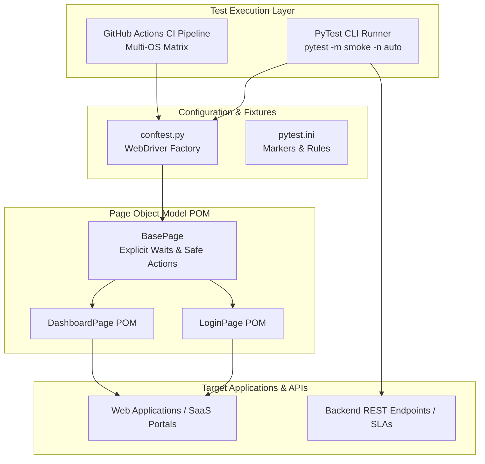

# :test_tube: Production QA Test Automation Framework

[](https://python.org)
[](https://selenium.dev)
[](https://pytest.org)
[](.github/workflows/test.yml)

An enterprise-grade, maintainable QA test automation framework built on Python, Selenium WebDriver 4, and PyTest. Implements the **Page Object Model (POM)** architectural pattern, multi-browser parallel test execution, API contract validation, and automated GitHub Actions CI/CD test reporting.

---

## :triangular_ruler: Framework Architecture



---

## :sparkles: Key Framework Features

- **Page Object Model (POM)**: Strict separation of test assertions from UI locators, eliminating brittle selectors and test maintenance overhead.
- **Explicit Dynamic Waits**: Zero hardcoded `sleep` calls. All interactions rely on `WebDriverWait` and `expected_conditions`.
- **Parallel Cross-Browser Execution**: Native support for running regressions across Chrome and Firefox concurrently (`pytest-xdist`).
- **Full-Stack Validation**: Seamlessly tests both UI frontend flows and backend REST API latency SLAs within a single unified runner.
- **CI/CD Integration**: Executes headless regressions automatically on every pull request, outputting JUnit XML test reports and failure screenshots.

---

## :rocket: Getting Started

### 1. Installation
```bash
git clone https://github.com/Aryan-136/qa-automation-framework.git
cd qa-automation-framework

python -m venv venv
source venv/bin/activate  # On Windows: .\venv\Scripts\Activate.ps1
pip install -r requirements.txt
```

### 2. Running Test Suites
```bash
# Run critical smoke tests
pytest -m smoke

# Run full regression suite in parallel (4 workers)
pytest -m regression -n 4

# Run API SLA validation tests
pytest tests/api/

# Run with HTML test report generation
pytest --html=report.html --self-contained-html
```

---

## :file_folder: Repository Layout
```text
.
├── .github/
│   └── workflows/
│       └── test.yml              # Automated CI matrix execution
├── pages/
│   ├── base_page.py              # Foundational Page Object with explicit waits
│   └── login_page.py             # Authentication portal POM
├── tests/
│   ├── api/
│   │   └── test_telemetry_api.py # REST API contract & latency tests
│   └── e2e/
│       └── test_auth.py          # End-to-end browser authentication flows
├── conftest.py                   # PyTest browser fixtures & CLI parameters
├── pytest.ini                    # Test execution rules and custom markers
├── requirements.txt              # Framework dependencies
└── README.md                     # Architectural documentation
```